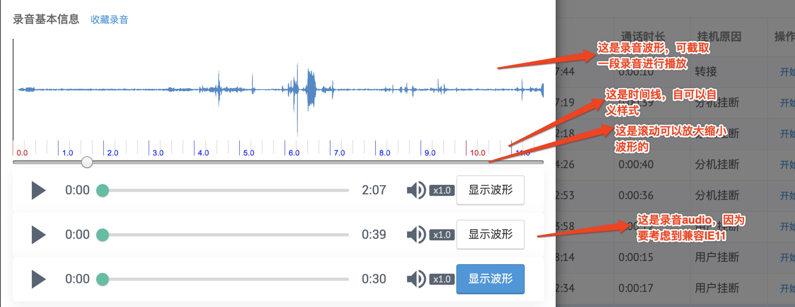

<h3 id="今天来说一下我用wavesurfer遇到的那些坑">今天来说一下我用wavesurfer遇到的那些坑</h3>
因为要考虑到兼容IE11，还有多录音列表的展示，所以还是用原来的audio模块，在原有基础上再添加一个div做录音波形展示(IE11以上的显示录音波形，IE11以下只显示原生的audio)

效果展示

<pre><code>代码块：
    wavesurfer = WaveSurfer.create({
        container: wave[0],
        waveColor: '#428bca',
        progressColor: '#31708f',
        scrollParent: true,
        normalize: true,
        backend: 'MediaElement',
        plugins: [
            WaveSurfer.timeline.create({
                container: time[0],
                formatTimeCallback: BANG_audio.formatTimeCallback,
                timeInterval: BANG_audio.timeInterval,
                primaryLabelInterval: BANG_audio.primaryLabelInterval,
                secondaryLabelInterval: BANG_audio.secondaryLabelInterval,
	            primaryColor: 'blue',
	            secondaryColor: 'red',
	            primaryFontColor: 'blue',
	            secondaryFontColor: 'red'
            }),
            WaveSurfer.regions.create({  })
       ]
    })</code></pre>

遇到的问题：   ① 模块包，注意：在npm、jsDelivr里面下载wavesurfer的包，所提供的方法跟官方文档真的是好多都不一样

<pre><code>比如说：官方文档上说的创建是create，但是npm、jsDelivr里面说的是init，而且不支持放在 plugins[] 中
解决方法： 所需下载的包在unpkg上面，比如： https://unpkg.com/wavesurfer.js
</code></pre>
  ② 判断audio哪个是否在播放状态中     解决方法：  audio.duration &gt; 0 &amp;&amp; !audio.paused

  ③ 报错信息： <code>Failed to set the 'currentTime' property on 'HTMLMediaElement': The provided double value is non-finite.</code>     解决方法： 这个是似乎jQuery与Web音频API不兼容，所以还是用原生的document.getElementById(‘’)

<a href="https://wavesurfer-js.org/" target="_blank" rel="noopener">官方文档参考</a>

