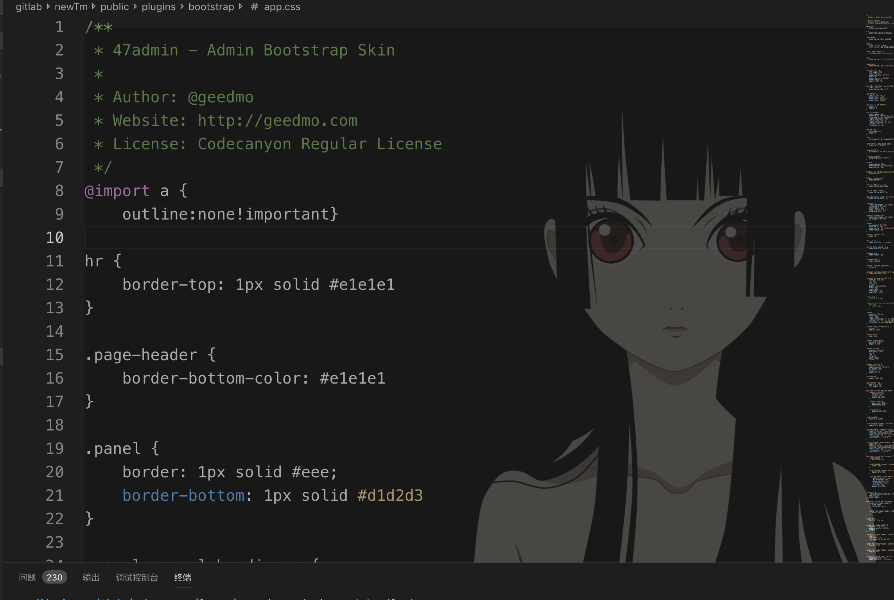
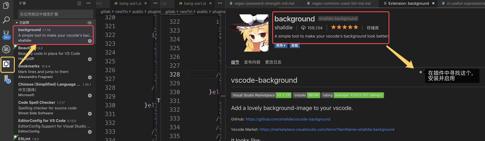

<h4 id="1-每次看vscode的界面时，都是自己码的代码，太无趣了，所以增加了一个背景图，嗯，看着还不错">1. 每次看vscode的界面时，都是自己码的代码，太无趣了，所以增加了一个背景图，嗯，看着还不错</h4>
看我的背景：

步骤放在这里啦： 

<pre><code>插件启用成功后，在设置里面在setting.json 中编辑，增加以下字段，再重启vscode就好了

"update.enableWindowsBackgroundUpdates": true,
    "background.customImages": [
        "file:///Users/wellcloud/Desktop/WechatIMG4.jpeg"//图片地址
    ],
    "background.style": {
        "content":"''",
        "pointer-events":"none",
        "position":"absolute",//图片位置
        "width":"100%",
        "height":"100%",
        "z-index":"99999",
        "background.repeat":"no-repeat",
        "background-size":"100%,100%",//图片大小
        "opacity":0.2 //透明度
    },
    "background.useFront": true,
    "background.useDefault": false,//是否使用默认图片</code></pre>
