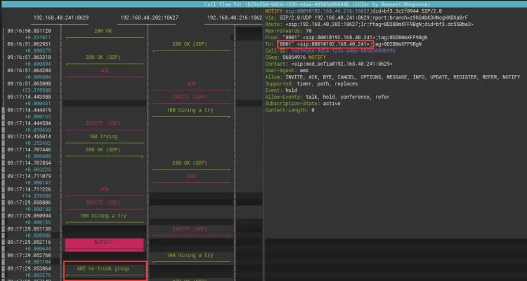
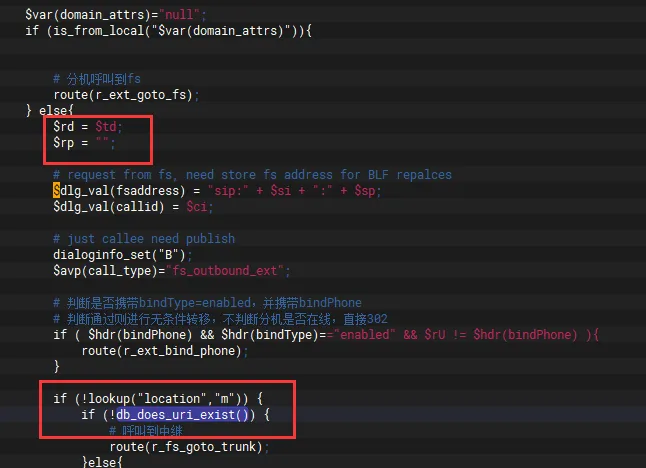

## 🚨 问题现象

OpenSIPS 返回 `402 no trunk group` 错误。



---

## 🔍 问题分析

### 错误含义

**402 no trunk group** 是 OpenSIPS 自定义错误码，表示：

- 脚本中未找到 `$avp(trunk_group)` 中继组变量
- 无法确定通过哪个中继组进行路由
- 呼叫被拒绝并返回 402 错误

### 触发逻辑

在 OpenSIPS Core 脚本中的判断逻辑：

```bash
if(!is_avp_set("$avp(trunk_group)")) {
    sl_send_reply("402", "no trunk group");
    route(r_metadata_json, 402, "no trunk group");
    exit();
}
```

---

## 🛠️ 找路由组逻辑

### 路由顺序

```
1️⃣ 分机号 → 路由组 → 中继组
2️⃣ 域名 → 路由组 → 中继组
```

### 详细流程

```
┌─────────────┐     ┌─────────────┐     ┌─────────────┐
│  分机号/域名 │ ───>│   路由组    │ ───>│   中继组     │
└─────────────┘     └─────────────┘     └─────────────┘
                           │                    │
                           │                    ↓
                           │            $avp(trunk_group)
                           │                  (未设置)
                           │                    ↓
                           │            ❌ 402 no trunk group
                           ↓
                   查询数据库视图
```

---

## 🏢 UC 环境特别说明

### 分机号正则匹配机制

在 UC 环境中，分机绑定的路由组查询依赖于正则匹配：

```
┌─────────────┐     ┌─────────────┐     ┌─────────────┐
│   分机号    │ ───>│  正则匹配    │ ───>│   路由组    │
└─────────────┘     └─────────────┘     └─────────────┘
     │                                     │
     │    匹配失败                          │
     └─────────────────────────────────────┤
                                          │
                                          ▼
                                   ❌ 查询不到路由组
                                          │
                                          ▼
                                   ❌ 402 no trunk group
```

**关键逻辑**：
- 如果分机号正则匹配不上，分机绑定的路由组将查询不到
- 如果没有 `prefix_extension` 字段，脚本会自动将分机号替换为以 **8** 开头

### domain 表 attrs 字段配置

```
┌─────────────────────────────────────────────────────────┐
│  prefix_num=4;prefix_relay=^9;prefix_extension=^7[0-9]{3,8}$  │
└─────────────────────────────────────────────────────────┘
```

#### 参数说明

| 参数 | 说明 | 示例 |
|------|------|------|
| `prefix_num` | 缩位拨号启用，区域号位数 | `prefix_num=4` |
| `prefix_relay` | 外呼到中继的前缀 | `prefix_relay=^9` |
| `prefix_extension` | 分机号正则匹配 | `prefix_extension=^7[0-9]{3,8}$` |

#### 常见正则表达式

| 正则表达式 | 匹配规则 | 示例 |
|-----------|---------|------|
| `^7[0-9]{3,8}$` | 7开头，3-8位数字 | 7001, 712345678 |
| `^8[0-9]{4}$` | 8开头，4位数字 | 80001, 89999 |
| `^[0-9]{4,6}$` | 任意4-6位数字 | 1000, 123456 |

### UC 环境故障场景

**场景：分机号正则匹配失败**

```
分机号: 7001
domain attrs: prefix_extension=^8[0-9]{4}$

结果: ❌ 7001 不匹配 ^8[0-9]{4}$
     → 查询不到路由组
     → 返回 402 no trunk group
```

**处理逻辑**：

如果没有配置 `prefix_extension` 字段，脚本会自动将分机号替换为以 **8** 开头再进行匹配：

```
原始分机: 1001
无 prefix_extension 配置
↓
自动替换: 81001
↓
使用 81001 进行路由组查询
```

---

## 💡 常见原因与解决方案

### 原因一：数据库视图不存在

**现象**: 设置了路由组，但仍然报 402 错误

**原因**: 查询路由组时使用的是视图，如果视图不存在则无法查询

### 原因二：分机未绑定路由组

**现象**: 找不到分机号对应的路由组

---

## 📨 NOTIFY 收到 402

### 问题现象



NOTIFY 请求发送到 Core 后收到 402 错误。

### 问题原因

NOTIFY 找分机是通过 RURI (Request-URI) 查找的，在执行判断之前：

1. 脚本会先把 `$rd` (Request Domain) 改成 `$td` (To Domain)
2. 如果 `$td` 里面没有域名，就找不到分机号
3. 最终返回 402 no trunk group

### 解决方案

#### 方案一：检查 NOTIFY 请求格式

确保 NOTIFY 请求的 To 头包含正确域名：

```bash
# 抓包检查 NOTIFY
tcpdump -i any -n -s 0 port 5060 -A | grep -i notify
```

正确的 NOTIFY 格式：

```
NOTIFY sip:user@domain.com SIP/2.0
To: <sip:user@domain.com>
From: <sip:server@domain.com>
```

#### 方案二：修改脚本逻辑

如果 `$td` 为空，使用 `$rd` 作为备选：

```bash
# OpenSIPS 脚本修改
if(!$td) {
    $td = $rd;
}
```

---

## 🔗 相关文档

- [外呼 480 Temporarily Unavailable](./外呼480-Temporarily-Unavailable.md)
- [499 Edge Send Timeout](./499-Edge-Send-Timeout.md)
- [故障排查](../fs/故障排查/)
